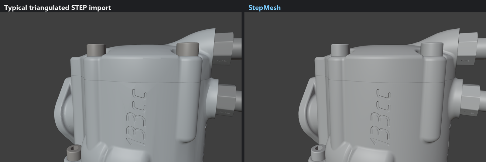
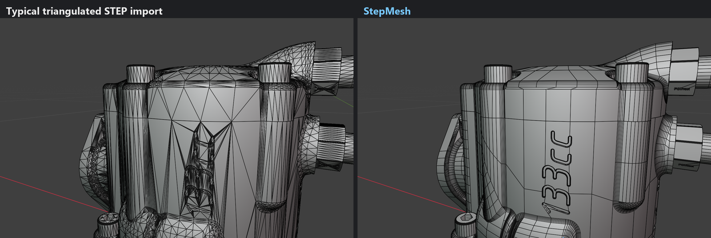
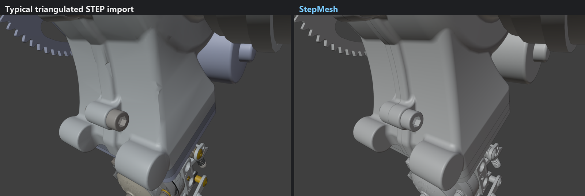
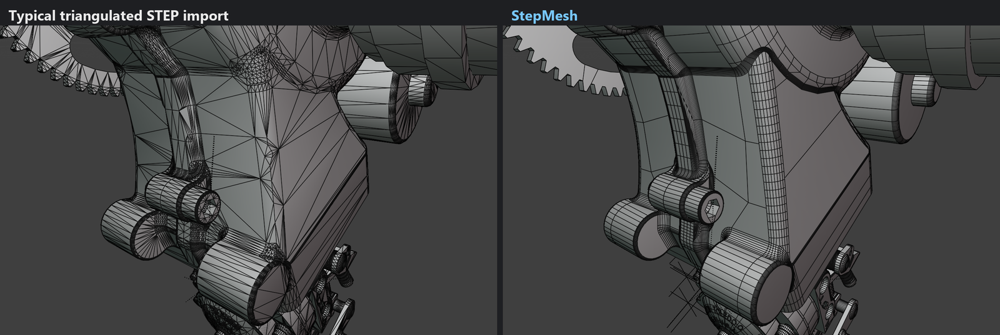

# StepMesh

Free, open source STEP to polygon mesh converter that produces clean, quad-dominant topology: grids that follow the surfaces' own flow lines, ngons instead of triangle fans at holes and trims, and watertight output.


- Fillets and cylinders become tidy quad strips, spheres and tori become lat-long grids.
- Cut and trimmed surfaces keep their grid. Cells cut by a hole become ngons rather than slivers.
- Every shared edge is divided once, so the mesh is welded and watertight by construction.
- Normals come from the exact CAD surface.
- Exports OBJ, FBX, PLY, STL and GLB, with real units (mm to m for Blender) and Z-up or Y-up.

## Compared with a typical STEP import

Same model, same camera, Blender solid shading. Left: a typical triangulated STEP import. Right: StepMesh.

Flat faces stay flat and lettering stays crisp, because the mesh follows the surfaces' own grid and carries the exact CAD normals instead of smoothing across long sliver triangles:




Cast fillets and blends stay smooth, without dents or blotches, with fewer polygons (376,685 against 593,385 for the whole engine):




Model: [Two stroke engine 133cc](https://grabcad.com/library/two-stroke-engine-133cc-1) by Design to Steel, from the GrabCAD Community library, used for these comparison images only.

## Download (Windows)

Get `StepMesh-windows.zip` from the [Releases](../../releases) page, unzip it anywhere and run `StepMesh.exe`. No install or Python needed. Keep the `_internal` folder next to the exe.

Windows may warn that the app is from an unknown publisher (it is not code-signed). Click **More info**, then **Run anyway**.

## Blender add-on

Import STEP files straight into Blender (4.2 or newer, Windows).

1. From the [Releases](../../releases) page download the add-on zip for your Blender:
   - `stepmesh_blender-...-blender4.2-5.0-windows-x64.zip` for Blender 4.2 to 5.0
   - `stepmesh_blender-...-blender5.1-plus-windows-x64.zip` for Blender 5.1 and newer
2. In Blender drag the zip onto the window, or use Edit > Preferences > Get Extensions > (menu) > Install from Disk.
3. Use **File > Import > STEP (.step/.stp)**. Meshing runs in the background on all CPU cores, with progress in the status bar (Esc cancels).

The STEP product tree is kept: assemblies and sub-assemblies become Empties with their CAD names, every part instance becomes a named object at its CAD position, and parts used several times (screws, bolts) are meshed once and shared as linked duplicates. Each part has the exact CAD normals as custom normals, true size (millimetres become metres by default) and a `cad_face` face attribute telling which CAD surface every polygon came from. The **StepMesh** tab in the 3D View sidebar shows the settings of the selected import and a **Re-mesh** button, which rebuilds it in place without reading the file again.

To build the add-on zips yourself: `python tools/build_blender_extension.py` (they appear in `dist/`).

## Run from source

Needs Python 3.11 ([python.org](https://www.python.org)).

```bash
git clone https://github.com/<your-account>/stepmesh.git
```

Then in the `stepmesh` folder double-click `setup.bat` once, and `run.bat` to start the app. On macOS or Linux:

```bash
python3.11 -m venv .venv && .venv/bin/pip install -r requirements.txt && .venv/bin/python StepMesh.pyw
```

## Using the app

- **Open** a `.step`, `.stp` or `.brep` with Ctrl+O, by dropping it on the window, or from Open recent. It meshes straight away.
- **Mesh settings:** density preset or angle, divide larger than, avoid smaller than, aspect ratio limit, output (N-gons, Quads & triangles, Triangles), trim handling and sharp edge angle. Click **Update mesh** or tick auto-update.
- **View:** colour by clay, by CAD surface, or by polygon type (quads blue, triangles orange, ngons green). Toggle polygon edges, flat shading, back-face highlight and open-edge highlight. Left drag orbits, middle or right drag pans, the wheel zooms, F frames.
- **Model info** shows polygon counts and a watertight check.
- **Export** with Ctrl+E.

## Command line

```bash
python -m stepmesh part.step -o part.obj
```

Common options: `-a 12` (angle in degrees), `-t ngons|quads|tris`, `--max-edge 5`, `--min-edge 0.5`, `--aspect 2`, `--weld all|smooth|none`. The output format follows the file extension (`.obj .fbx .ply .stl .glb`). Run `python -m stepmesh -h` for everything.

## Building the Windows app

After `setup.bat`, run `build.bat`. It runs the tests, builds `dist\StepMesh\StepMesh.exe` and zips it. Pushing a version tag (`git tag v0.1.0` then `git push --tags`) makes GitHub build the zip and attach it to a release automatically.

## Tests

```bash
python tests/run_tests.py
```

It meshes every part in `tests/parts` in all three output modes and fails on any open edge or flipped polygon. `tools/make_test_parts.py` regenerates the parts (needs `requirements-dev.txt`), and `tools/analyze_obj.py` reports duplicate vertices and open edges in any OBJ.

## How it works

See [docs/ALGORITHM.md](docs/ALGORITHM.md). It is an independent implementation built on OpenCASCADE and published geometry techniques.

## License

MIT, see `LICENSE`. Third-party libraries are listed in `THIRD_PARTY_NOTICES.md`. Note that the Triangle library used for some triangulations is free for non-commercial use only, so builds that include it may not be sold.
